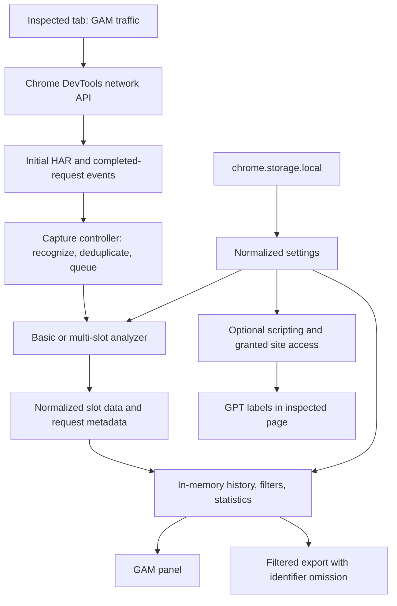

# AdTrace GAM Inspector

A local-first Chrome DevTools extension that turns Google Ad Manager network requests into actionable insights about ad delivery, targeting, and privacy signals.

[](manifest.json)
[](LICENSE)
[](manifest.json)
[](package.json)

The extension is registered as **GAM** in Chrome and adds a **GAM** panel to DevTools. It captures supported ad requests, reconstructs individual slots, and presents a searchable request stream with delivery statistics and privacy-aware JSON export.

> [!IMPORTANT]
> This repository contains a browser extension with reusable request-analysis modules, not a published general-purpose logging library. The package is private; there is no supported npm installation, logger initialization API, log-level system, custom formatter interface, or server-side log transport. The workflows below describe the implementation in this repository.

## Table of Contents

- [Features](#features)
- [Tech Stack & Architecture](#tech-stack--architecture)
  - [Project Structure](#project-structure)
  - [Key Design Decisions](#key-design-decisions)
- [Getting Started](#getting-started)
  - [Prerequisites](#prerequisites)
  - [Installation](#installation)
  - [Local UI Preview](#local-ui-preview)
- [Testing](#testing)
  - [Automated Tests](#automated-tests)
  - [Manual Browser Integration Tests](#manual-browser-integration-tests)
  - [Syntax and Formatting Checks](#syntax-and-formatting-checks)
- [Deployment](#deployment)
  - [Build and Packaging](#build-and-packaging)
  - [CI/CD Integration](#cicd-integration)
  - [Distribution and Operational Guidance](#distribution-and-operational-guidance)
- [Usage](#usage)
  - [Inspect Requests in DevTools](#inspect-requests-in-devtools)
  - [Analyze a Request Programmatically](#analyze-a-request-programmatically)
- [Configuration](#configuration)
  - [Settings and Persistence](#settings-and-persistence)
  - [Permissions and Content Security Policy](#permissions-and-content-security-policy)
  - [Environment Variables and Startup Flags](#environment-variables-and-startup-flags)
- [License](#license)
- [Support the Project](#support-the-project)

## Features

### Capture and analysis

- **Native DevTools integration:** a dedicated GAM panel uses Chrome's inspected-tab network APIs rather than installing a network proxy.
- **Initial HAR ingestion and live capture:** imports available network entries on panel initialization and listens for completed requests afterward.
- **Endpoint-aware recognition:** accepts HTTP(S) requests to `/gampad/ads` or `/pagead/ads`, with an optional trailing slash, on `doubleclick.net`, `googlesyndication.com`, and their subdomains. Rejects unrelated paths and lookalike domains.
- **Multi-slot request reconstruction:** expands `iu_parts` and `enc_prev_ius` into separate ad-unit paths and aligns sizes, targeting, and response header IDs by slot position.
- **Single-slot request analysis:** reads `iu`, `sz`, and `scp` from supported basic ad requests.
- **GET and POST parameter handling:** supports HAR query arrays, URL query fallback, form-encoded POST text, and supported HAR POST parameter arrays.
- **Delivery metadata:** extracts creative and line-item IDs from response headers; classifies slots as filled, unfilled, or unknown.
- **Optional response enrichment:** attempts to extract winning advertiser, order, and creative size from supported multi-slot response bodies.
- **Privacy signals:** reads `npa`, `gdpr`, `gdpr_consent`, and PPID; distinguishes explicit signals from absent information.
- **Video metadata:** exposes `env`, `output`, `plcmt`, `vpa`, `vpmute`, and `vpos` on basic requests when present.
- **Defensive parsing:** tolerates missing headers, malformed percent escapes, invalid JSON, unavailable response content, and content callback failures.

### Investigation workflow

- **Searchable stream:** case-insensitive substring search across ad units, sizes, entity IDs, advertiser labels, and decoded page/slot targeting.
- **Slot-level filters:** all requests, filled, unfilled, video, and privacy signals; request cards remain visible when at least one slot matches.
- **Session statistics:** retained request count, slot count, known-status fill rate, and average available network duration.
- **Expandable details:** request cards and lazily constructed slot detail panels keep larger sessions easier to navigate.
- **Copy ad-unit paths:** clipboard controls with a fallback notice when browser clipboard access is unavailable.
- **Pause/resume and clear:** stop accepting new requests or discard captured records and pending results.
- **Preserve log:** optionally retain records and in-flight analysis across inspected-page navigation.
- **Bounded history:** retain 50–2,000 requests, with a default of 250 and automatic eviction of older records.
- **Duplicate suppression:** avoids counting the same initial-HAR/live event twice, including POST payload-aware identity.
- **Bounded concurrent analysis:** processes at most four requests simultaneously and drops the oldest queued work under sustained overflow with a user-facing notice.
- **Direct GAM links:** links supported numeric creative, line-item, order, and advertiser IDs to a configured matching GAM network.
- **Targeting highlights:** configurable featured keys remain visible when their surrounding targeting sections are hidden.
- **Header-bidding labels:** advertiser aliases support Prebid and Amazon winner summaries; optional maps decode Amazon prices and bidder names, including zero-valued prices.
- **Optional GPT overlays:** labels rendered slot element IDs and measured dimensions on explicitly allowed sites.
- **Filtered JSON export:** downloads only matching requests and slots, with consent-string and PPID omission controlled by privacy settings.
- **Light, dark, and system themes:** persistent appearance preferences and a quick panel toggle.
- **Keyboard and accessibility affordances:** Ctrl/Cmd+K search focus, Escape filter reset while search is focused, labeled controls, and live status messages.
- **Fixture-driven preview:** explore the UI outside DevTools using sample request data and a synthetic video request.

### Local-first behavior

- No runtime npm dependencies, framework, bundler, backend, or external telemetry service.
- Settings persist in `chrome.storage.local`, not Chrome sync storage.
- Request records live in the panel's memory; preserve-log mode is not durable storage.
- Basic request inspection does not require optional host or scripting permission.
- Overlay access is explicitly requested and revocable per site.
- Export serializes selected analysis fields rather than raw HAR entries, request URLs, or cookie collections.

> [!WARNING]
> Local processing does not make captured data anonymous. Targeting values can contain user identifiers, commercially sensitive information, or personal data. Review exports before sharing; hiding a targeting section does not remove its values from the export.

## Tech Stack & Architecture

| Component | Implementation |
| --- | --- |
| Runtime | Chrome extension, Manifest V3; minimum Chrome version 111 |
| Language | Native JavaScript ES modules, including top-level `await` for settings initialization |
| UI | Static HTML, CSS, DOM APIs, inline SVG icons, and local image assets |
| Capture | `chrome.devtools.network.getHAR`, `onRequestFinished`, and `onNavigated` |
| Persistence | `chrome.storage.local` and `chrome.storage.onChanged` |
| Optional overlays | `chrome.permissions`, `chrome.scripting.executeScript`, and Google Publisher Tag (GPT) |
| Export | JSON serialization, `Blob`, object URLs, and a browser download link |
| Tests | Node.js built-in `node:test`, `node:assert/strict`, and JSON fixtures |
| Formatting convention | `.prettierrc`; no formatter dependency or npm script is installed |
| Runtime dependencies | None declared in `package.json` |

### Project Structure

<details>
<summary>Complete source layout and module responsibilities</summary>

```text
adtrace-gam-inspector/
├── README.md                         # Project documentation
├── LICENSE                           # Apache License 2.0
├── manifest.json                     # Extension metadata, permissions, and CSP
├── package.json                      # Private ES-module package; Node test script
├── .prettierrc                        # Formatting preferences
├── devtools.html                     # DevTools extension entry document
├── devtools.js                       # Registers the GAM panel
├── panel.html                        # Request stream, filters, and session statistics
├── options.html                      # Settings and optional site-permission UI
├── chrome.png                        # Additional image asset
├── assets/
│   ├── css/
│   │   ├── styles.css                # Panel styling
│   │   ├── options.css               # Settings styling
│   │   └── theme.css                 # Shared theme tokens
│   ├── images/
│   │   ├── icon-16.png
│   │   ├── icon-32.png
│   │   ├── icon-48.png
│   │   ├── icon-128.png
│   │   ├── mark.svg
│   │   └── request-inspector.webp
│   └── js/
│       ├── app.js                    # DevTools wiring, overlay lifecycle, demo loading
│       ├── capture.js                # Deduplication, queue, pause, and generation guards
│       ├── analyze.js                # Endpoint recognition and request/response parsing
│       ├── display.js                # In-memory records, DOM rendering, filters, statistics
│       ├── export.js                 # Versioned JSON serialization and identifier omission
│       ├── settings.js               # Defaults, normalization, storage, subscriptions
│       ├── options.js                # Settings form validation and permission grants
│       ├── overlay.js                # GPT slot labels and cleanup inside the inspected page
│       ├── ui.js                     # DOM helpers and SVG icons
│       └── utils.js                  # Query/header helpers, safe JSON, and status labels
└── tests/
    ├── analyze.test.js               # Parser, settings, and export regression tests
    ├── capture.test.js               # Capture lifecycle and queue regression tests
    ├── request.json                  # Multi-slot request fixture
    ├── request-anonymous.json        # Privacy-signal fixture
    ├── request-unfill.json           # Multi-slot unfilled fixture
    ├── request-basic.json            # Basic request fixture
    ├── request-basic-unfill.json     # Basic unfilled fixture
    ├── test.html                     # Redirect to the sample-data panel
    └── test.js                       # Fixture-driven UI preview loader
```

There is no checked-in build pipeline, Docker configuration, lockfile, automated browser runner, or GitHub Actions workflow.

</details>

### Key Design Decisions



1. **Separate capture from presentation.** `createCaptureController()` coordinates ingestion through callbacks; `display.js` owns records and rendering. Tests exercise capture without a browser DOM.
2. **Use native extension capabilities.** Capture observes the inspected tab through DevTools. The manifest has no background service worker or permanently declared content script.
3. **Make intrusive capabilities optional.** Basic inspection runs without site injection. Overlays require the optional `scripting` permission and an explicit host grant.
4. **Bound work and retained state.** Queue limits, concurrent workers, history eviction, response limits, and lazy slot rendering reduce the cost of busy ad pages.
5. **Preserve uncertainty.** Missing delivery IDs and privacy flags remain unknown/unspecified instead of being presented as definitive outcomes.
6. **Minimize exported information.** Export uses normalized analysis records, not full HAR objects; the default export omits consent strings and PPID.
7. **Keep settings local and reactive.** Storage changes propagate to open panels; module consumers without Chrome storage use in-memory defaults.

<details>
<summary>Capture lifecycle, concurrency, and interpretation details</summary>

- The controller assigns increasing request IDs at acceptance time. The display sorts by descending ID, not by response parsing completion or timestamp.
- Duplicate identity includes start time, method, URL, and, for POST requests, parsed parameter pairs. The seen-key set is bounded to approximately twice the configured history limit. Suppression is therefore not a permanent global uniqueness guarantee.
- At most four analyses run concurrently. The pending queue is bounded by `maxRequests`; overflow resolves and removes the oldest queued item and emits a notice.
- **Clear** advances a generation token, clears deduplication state, and removes queued work. Active callbacks may still finish, but obsolete results do not enter the stream.
- Navigation advances a separate navigation counter. Without preserve-log mode it also invalidates old work and clears displayed history.
- The initial `getHAR()` callback is guarded against navigation or clear events that happen before it returns.
- Pause rejects new input; it does not cancel work already accepted. Resume does not automatically replay requests missed while paused.
- Statistics describe retained records, not lifetime page totals or only the filtered subset. Fill rate is `filled / (filled + unfilled)`; unknown slots are excluded. Average response time uses available non-negative HAR durations, not parser execution time.
- `google-lineitem-id: -2` means unfilled. An absent ID or `-1` means unknown. Other nonempty line-item IDs are classified as filled by the current implementation.
- Privacy labels prioritize non-personalized requests, then GDPR applicability and consent presence. They describe observed parameters, not legal compliance or consent validity.
- The **Privacy signals** filter matches `isAnonymous`: `npa=1`, or `gdpr=1` with no consent string. It does not select every request containing any GDPR-related parameter.

</details>

## Getting Started

### Prerequisites

- **Google Chrome 111 or later** for the extension runtime. Prefer a currently maintained Chrome release; compatibility with other Chromium browsers is not verified here.
- **Git** to clone the repository, or a downloaded source archive from GitHub.
- **Node.js 20 or later and npm** to run automated tests and the developer examples. Node.js is not needed merely to load the unpacked extension.
- Permission to enable Chrome Developer mode and load unpacked extensions on your device. Managed browser policies may restrict this.
- A page issuing supported GAM requests for live inspection. GPT is needed only for the optional slot overlays.
- **Optional:** Python 3 for the static preview server; `zip` for the packaging example.

### Installation

```bash
# Obtain the extension source.
git clone https://github.com/adops-tool/adtrace-gam-inspector.git
cd adtrace-gam-inspector

# Check the developer runtime and run the regression suite.
node --version
npm --version
npm test
```

**Dependency installation:** there are no declared runtime or development npm dependencies, so `npm install` is unnecessary. The checkout already contains the extension's executable source. There is no build step before loading it.

1. Open `chrome://extensions` in Chrome.
2. Enable **Developer mode**.
3. Click **Load unpacked**.
4. Select the repository directory containing `manifest.json`.
5. Open the page you want to inspect and open DevTools.
6. Select the **GAM** panel, using the DevTools overflow menu if necessary.
7. Reload the inspected page or trigger an ad refresh to populate the stream.

> [!TIP]
> Open DevTools and the GAM panel before reproducing the issue. Initial HAR ingestion imports entries Chrome has retained, but it cannot recover requests that were never available to DevTools.

<details>
<summary>Alternative installation and troubleshooting</summary>

**Source archive instead of Git:** download the repository archive from [GitHub](https://github.com/adops-tool/adtrace-gam-inspector), extract it, and load the extracted directory containing `manifest.json`. Do not select the ZIP file itself or its parent directory.

**Extension does not load:** confirm Chrome is at least version 111, the directory contains the manifest and referenced assets, and organizational policies allow unpacked extensions. Check the extension's error details on `chrome://extensions`.

**GAM panel is missing:** reload the extension on `chrome://extensions`, close and reopen DevTools, and check the overflow menu. Opening `panel.html` directly is not equivalent to opening the DevTools panel.

**No requests appear:** resume capture, reset search/status filters, reload the inspected page, and confirm Chrome's Network panel contains a supported endpoint with `iu` or `iu_parts`. Ad blockers, consent flows, or lazy loading may prevent requests from occurring. Arbitrary GAM-related URLs are not recognized.

**Source changes do not appear:** reload the extension and reopen DevTools after editing its files. There is no hot-reload watcher.

**Additional winner details are empty:** enable response enrichment before capturing the request; basic requests do not receive this enrichment. Response content must be available through Chrome's `getContent()` callback and match the supported parser layout.

**Overlays do not appear:** open installed-extension Settings, grant the exact HTTP(S) site, enable overlays, save, and reload the inspected page. GPT must be available and slots must render. Restricted browser pages cannot receive ordinary site injections.

**Settings cannot be saved in a static preview:** the preview does not provide Chrome extension storage or site-permission APIs. Its settings are in-memory, and permission grants must be made in the installed extension.

</details>

### Local UI Preview

Serve the repository root over HTTP rather than opening the module pages through `file://`:

```bash
# Optional UI-only preview; run from the repository root.
python3 -m http.server 8000 --bind 0.0.0.0
```

Open `/panel.html?demo=1` on that server, for example `http://localhost:8000/panel.html?demo=1` when browsing on the same machine. `tests/test.html` redirects to that route. For a hosted development workspace, use its forwarded preview URL with the same path instead of your browser's `localhost`.

The panel displays **Preview mode** and loads sample data. `/panel.html` without `demo=1` shows the empty preview. `/options.html` previews the settings UI.

> [!NOTE]
> The static server is only a developer convenience, not a live capture backend. It does not provide DevTools APIs, persistent extension settings, or overlay permission management. Binding to `0.0.0.0` exposes the server on available interfaces; use only in a trusted development environment and stop it when finished.

## Testing

### Automated Tests

```bash
# Run the complete automated regression suite.
npm test

# Parser, settings, utilities, and export unit/fixture tests.
node --test tests/analyze.test.js

# Capture-controller integration tests with fixtures and simulated callbacks.
node --test tests/capture.test.js
```

The current suite contains **16 tests**: 10 in `analyze.test.js` and 6 in `capture.test.js`. It uses Node's built-in test runner and needs no package installation or browser driver.

<details>
<summary>Regression coverage and optional coverage reporting</summary>

The suite covers:

- Existing basic, multi-slot, anonymous, and unfilled request fixtures.
- Rejection of invalid URLs, unrelated endpoints, and domain lookalikes.
- Missing fields, case-insensitive headers, malformed escapes, and decoding-layer behavior.
- URL fallback and form-encoded POST targeting.
- Unknown delivery status and absent versus explicit privacy signals.
- Supported response JSON, base64 decoding, invalid lines, and slot-position preservation.
- Oversized content, unavailable callbacks, callback exceptions, and the response timeout.
- Settings normalization and rejection/filtering of prototype-related map keys.
- Export omission of hidden identifiers and raw HAR URLs/cookies.
- Initial-HAR/live deduplication, pause, clear, and resumed acceptance.
- Navigation invalidation and preserve-log behavior with in-flight parsing.
- Burst queuing and distinct POST payloads at the same timestamp.

Node releases supporting the experimental coverage flag can produce a terminal coverage report:

```bash
node --test --experimental-test-coverage tests/*.test.js
```

Coverage support and output may vary by Node version. There is no checked-in coverage threshold, uploaded coverage report, or coverage badge. Node tests do not verify DOM rendering, real permission prompts, clipboard behavior, downloads, or Chrome/GPT execution.

</details>

### Manual Browser Integration Tests

There is no automated end-to-end browser test command. Validate browser integration with the unpacked extension:

1. Open a page with supported GAM traffic; verify initial and newly completed requests appear once.
2. Compare ad-unit paths, sizes, targeting, and creative/line-item IDs with the Network panel.
3. Test search, every status filter, expandable slots, copy controls, and light/dark/system appearance.
4. Pause, generate more traffic, and resume; confirm paused input was not recorded. Allow for already accepted work to complete.
5. Navigate with preserve-log disabled and enabled; verify the expected reset/retention behavior.
6. Set a small history limit and confirm older records are evicted.
7. Export a filtered subset; verify only matching slots appear and hidden consent/PPID fields are absent.
8. Grant a site, enable overlays, render GPT slots, and test scrolling/resizing. Disable overlays, revoke site access, and reload the page to verify cleanup.
9. Enable additional response details and inspect a supported multi-slot response; confirm unavailable content does not interrupt capture.

Use the fixture preview for UI smoke testing when a live GAM page is unavailable; it is not a substitute for testing Chrome API integration.

### Syntax and Formatting Checks

No ESLint, `npm run lint`, or formatter script is configured. For a dependency-free JavaScript syntax check:

```bash
node --check devtools.js
for file in assets/js/*.js tests/*.js; do
  node --check "$file" || exit 1
done
```

<details>
<summary>Optional Prettier check using the repository's formatting preferences</summary>

`.prettierrc` specifies a 120-character print width, semicolons, single quotes, two-space indentation, and ES5 trailing commas. Prettier itself is not installed. To run it explicitly without changing `package.json`:

```bash
# Requires registry access; downloads the explicitly selected formatter version.
npx --yes prettier@3.6.2 --check \
  README.md '*.html' '*.js' '*.json' 'assets/css/*.css' 'assets/js/*.js' 'tests/*.js'
```

This is an optional formatting check, not a repository-provided semantic linter. Existing files can fail the check; review formatting changes separately rather than treating a downloaded formatter as an established CI gate.

</details>

## Deployment

### Build and Packaging

The extension is deployed as static source files. There is no `npm run build`, generated `dist/` directory, transpilation stage, or Docker image.

For local use, load the unpacked checkout as described in [Installation](#installation). To prepare a minimal ZIP for distribution review:

```bash
# Run from the repository root; keep the artifact outside the checkout.
npm test
zip -r ../adtrace-gam-inspector-0.1.0.zip \
  manifest.json devtools.html devtools.js panel.html options.html assets LICENSE
```

`manifest.json` must be at the archive root. The runtime requires the HTML entry points, JavaScript/CSS modules, and referenced assets. Review asset contents and license obligations before release.

> [!IMPORTANT]
> The minimal ZIP above intentionally excludes `tests/`. Normal DevTools operation does not require it, but the optional `?demo=1` static preview does. Include `tests/test.js` and the five request fixture JSON files in a separate preview bundle if you need that developer demonstration.

### CI/CD Integration

No CI/CD workflow is checked in. A proposed verification workflow can run the existing tests without an install step:

<details>
<summary>Example GitHub Actions workflow to add at .github/workflows/test.yml</summary>

```yaml
name: Tests

on:
  push:
  pull_request:

permissions:
  contents: read

jobs:
  test:
    runs-on: ubuntu-latest
    strategy:
      matrix:
        node: [20, 22, 24]
    steps:
      - uses: actions/checkout@v4
      - uses: actions/setup-node@v4
        with:
          node-version: ${{ matrix.node }}
      - name: Run regression tests
        run: npm test
      - name: Check JavaScript syntax
        shell: bash
        run: |
          node --check devtools.js
          for file in assets/js/*.js tests/*.js; do
            node --check "$file" || exit 1
          done
```

This is a suggested workflow, not a claim that hosted checks currently exist or pass. There is no lockfile, so do not use `npm ci` or npm dependency caching unless you first establish a dependency/lockfile workflow. Add browser smoke tests and packaging/release gates according to your distribution requirements.

</details>

### Distribution and Operational Guidance

- **Versioned releases:** keep `manifest.json` and `package.json` versions aligned; also update visible version labels in `panel.html` and this document.
- **Chrome Web Store:** prepare and validate the ZIP, describe storage and optional scripting/host permissions accurately, and follow the store's current submission requirements. No published store URL or automated publishing integration is defined in this repository.
- **Managed deployment:** use your organization's approved Chrome extension distribution process. Unpacked loading is a development/local-use workflow, not a claim of centrally managed installation support.
- **Permission review:** leave site scripting optional. Review any expansion of required permissions or host access as a security-sensitive change.
- **Data retention:** exporting is the provided way to retain a session beyond the panel's lifetime. There is no database, remote log shipping, automatic export scheduler, or import/replay UI for exported files.
- **Containerization:** Docker and Docker Compose are not required or provided. A container can serve the static preview, but live inspection still runs inside a compatible browser with the extension installed.
- **Release validation:** run automated tests, perform manual browser checks, and confirm that the packaged extension can be loaded from an extracted archive before distribution.

## Usage

### Inspect Requests in DevTools

1. Open DevTools on the page under investigation and select **GAM**.
2. Reload the page or trigger an ad request.
3. Expand a request and then a slot to inspect delivery IDs, targeting, sizes, and video parameters.
4. Search by ad-unit path, targeting key/value, size, or entity ID. Use **Ctrl/Cmd+K** to focus search and **Escape** while search is focused to reset filters.
5. Filter by delivery status, video, or the supported privacy-signal condition.
6. Set **GAM network ID** in Settings if you want entity links for requests belonging to that network.
7. Click **Export JSON** to download the currently matching requests and slots.

The download is named `gam-requests-<timestamp>.json`. Search and status filters affect exported slots; summary statistics still describe all retained records.

### Analyze a Request Programmatically

The analyzer modules can be imported directly from a checkout for local tooling or tests. This is source-level reuse, not a separately packaged, version-stable public library API.

Run this example from the repository root:

```bash
node --input-type=module <<'JS'
import {
  analyzeBasicAdRequest,
  isBasicAdRequest,
} from './assets/js/analyze.js';
import { getPrivacyLabel, getSlotStatus } from './assets/js/utils.js';

// A minimal HAR-like entry. Missing queryString falls back to the URL.
const entry = {
  request: {
    method: 'GET',
    url: 'https://securepubads.g.doubleclick.net/gampad/ads'
      + '?iu=%2F1234567%2Fexample%2Fsidebar'
      + '&sz=300x250&scp=hb_bidder%3Dexample%26hb_pb%3D1.20',
  },
  response: {
    status: 200,
    headers: [
      { name: 'google-creative-id', value: '98765' },
      { name: 'google-lineitem-id', value: '45678' },
    ],
  },
};

// Validate before invoking an analyzer directly.
if (isBasicAdRequest(entry)) {
  const slot = analyzeBasicAdRequest(entry);
  console.log(slot.adUnit);             // /1234567/example/sidebar
  console.log(getSlotStatus(slot));     // filled
  console.log(getPrivacyLabel(slot));   // Privacy unspecified
  console.log(new URLSearchParams(slot.slotTargetings).get('hb_bidder'));
}
JS
```

> [!NOTE]
> Direct analyzer functions parse their input; they do not enforce the controller's entire acceptance policy. Validate endpoint/type with the recognition helpers, or use the capture controller when processing untrusted or mixed network entries.

<details>
<summary>Advanced usage: fixture analysis, capture callbacks, and JSON export</summary>

The controller routes supported basic/multi-slot entries, deduplicates input, and emits normalized slots plus metadata. It does not store records or attach Chrome listeners for you.

```bash
node --input-type=module <<'JS'
import { readFile } from 'node:fs/promises';
import { createCaptureController } from './assets/js/capture.js';
import { serializeRequests } from './assets/js/export.js';
import { defaults } from './assets/js/settings.js';

const options = { ...defaults, preserveLog: true };
const records = [];
const controller = createCaptureController({
  getOptions: () => options,
  onRequest(slots, metadata) {
    // A custom consumer owns its own history/retention policy.
    records.push({ ...metadata, slots });
  },
  onNavigation(url) {
    console.log('Navigation:', url);
  },
  onError(message) {
    console.warn(message);
  },
});

const entry = JSON.parse(await readFile('./tests/request.json', 'utf8'));
await controller.accept(entry);
await controller.accept(entry); // Duplicate: no second record is emitted.

// Default privacy options omit gdprConsent and ppid fields.
console.log(JSON.stringify(serializeRequests(records, options), null, 2));
JS
```

`getOptions()` supplies capture lifecycle options such as `maxRequests` and `preserveLog`. Response-enrichment settings are read separately from the shared `settings` module; the controller does not pass arbitrary options into the analyzer.

`accept()` returns a promise for accepted queued work, but can return `undefined` for rejected, paused, or duplicate entries; `await` works for both. `setPaused(true)` stops new acceptance. `clear()` invalidates old work but does not clear your custom consumer's record array. `navigate(url)` invokes your navigation callback and applies generation invalidation according to preserve-log mode.

</details>

<details>
<summary>Advanced usage: optional winner enrichment and header-bidding labels</summary>

For multi-slot requests, **Read additional response details** enables `entry.getContent(callback)` retrieval. In DevTools, Chrome provides that callback API. A plain JSON HAR fixture does not contain a callable `getContent` method, so enabling the setting alone cannot retrieve its response body.

Supported response parsing:

- Accepts plain text or content reported with `encoding === 'base64'`.
- Examines newline-separated lines beginning with `{` after trimming whitespace.
- Selects an array-valued property from each JSON object.
- Reads height at array index 5, width at index 6, advertiser ID from index 16's first element, and order ID from index 17's first element.
- Preserves an empty winner position for malformed JSON-object lines so subsequent slot alignment is not silently shifted.

This is a best-effort parser for an observed response layout, not a supported Google protocol contract. Formats can change. Basic requests keep advertiser/order/winner-size fields empty even when enrichment is enabled. Enabling enrichment does not retroactively fetch content for existing records; recapture the request.

Configure advertiser names with a JSON object such as:

```json
{
  "123": "prebid",
  "456": "amazon",
  "789": "Direct campaign"
}
```

The exact labels `prebid` and `amazon` enable the corresponding bidder summaries. Prebid uses slot targeting `hb_bidder` and `hb_pb`; Amazon uses `amznp` and `amznbid`. Amazon price lookup strips leading `o_`, `v_`, and `amp_` prefixes from bid codes. These maps are local annotations, not live integrations with bidding platforms or proof of auction economics.

There is no custom logging formatter extension point. To build a custom report, consume normalized slots or `serializeRequests()` output and format them in your own tooling.

</details>

<details>
<summary>JSON export envelope and normalized slot fields</summary>

A representative export with default redaction settings:

```json
{
  "format": "gam-inspector",
  "version": 1,
  "exportedAt": "2026-10-14T12:00:00.000Z",
  "redacted": {
    "gdprConsent": true,
    "ppid": true
  },
  "requests": [
    {
      "id": 1,
      "startedDateTime": "2026-10-14T11:59:59.000Z",
      "duration": 85.4,
      "httpStatus": 200,
      "slots": [
        {
          "globalTargetings": "section=news",
          "isNPA": false,
          "isAnonymous": false,
          "gdpr": "",
          "httpStatus": 200,
          "adUnit": "/1234567/example/sidebar",
          "sizes": "300x250",
          "slotTargetings": "hb_bidder=example&hb_pb=1.20",
          "creativeId": "98765",
          "lineitemId": "45678",
          "orderId": "",
          "advertiserId": "",
          "advertiserWinner": "",
          "sizeWinner": null,
          "isUnfill": false,
          "video": null
        }
      ]
    }
  ]
}
```

| Field | Meaning |
| --- | --- |
| `format`, `version` | Export format identifier and schema version; `version: 1` is independent of extension version `0.1.0`. |
| `exportedAt` | Serialization time as an ISO timestamp. |
| `redacted` | Whether consent and PPID fields were omitted by the selected export settings. |
| `id` | Controller sequence number, or a sequence supplied by the consumer. |
| `startedDateTime` | Validated request start time; capture falls back to the current time if absent/invalid. |
| `duration` | Non-negative HAR `time` in milliseconds, or `null`. |
| `httpStatus` | Numeric response status, or `0` if unavailable in controller/analyzer output. |
| `adUnit` | Reconstructed or directly supplied ad-unit path. |
| `sizes` | Parsed size string; multiple candidate sizes may be separated by `\|`. |
| `globalTargetings`, `slotTargetings` | Decoded targeting query strings for page and slot scopes. |
| `creativeId`, `lineitemId` | Header-derived delivery IDs represented as strings. |
| `orderId`, `advertiserId` | Optional multi-slot response-derived IDs. |
| `advertiserWinner` | Local advertiser-map label, not an independently verified winner. |
| `sizeWinner` | Positive numeric `{ "width": ..., "height": ... }`, or `null`. |
| `gdpr`, `isNPA`, `isAnonymous` | Observed privacy parameters and derived booleans. |
| `gdprConsent`, `ppid` | Strings included only when the corresponding hide setting is false. |
| `isUnfill` | True when the slot's line-item header is `-2`. |
| `video` | Nonempty subset of supported basic-request video parameters, or `null`. |

There is no import UI or formal JSON Schema file. `serializeRequests()` shallow-copies supplied slot objects and removes the two configured identifier fields; custom consumers should not attach sensitive extra properties and assume an export allowlist will remove them.

</details>

<details>
<summary>Edge cases, parsing limits, and overlay behavior</summary>

| Guardrail | Current behavior |
| --- | --- |
| Request URL length | Controller rejects URLs longer than 131,072 characters. |
| Form-encoded POST text | Parsed up to 262,144 characters. |
| HAR POST parameter arrays | Up to 1,000 valid parameters, each with a value at most 131,072 characters. |
| Multi-slot expansion | Up to 200 encoded ad-unit entries. Invalid part indices are skipped. |
| Response parsing | Input string limited to 2 × 1,024 × 1,024 characters, including encoded input before base64 decoding. |
| Response callback | Times out after 1,500 ms; missing, failing, or late callbacks do not block capture indefinitely. |
| Parsed winners | Up to 200 response detail entries. |
| Concurrent analysis | Four active workers. |
| Pending queue | Bounded by `maxRequests`; oldest queued work is dropped on overflow. |
| Deduplication history | Approximately `maxRequests × 2` keys. |
| Retained UI history | 50–2,000 requests. |
| Featured keys | At most 100 distinct nonempty keys after normalization. |
| Displayed size badges | Up to 30 per slot. |
| Overlay labels | At most 200 slot labels. |

These limits are implementation constants, not configurable startup flags. String-length limits count JavaScript string length, not an exact network-byte budget.

Additional caveats:

- Query arrays take precedence over URL fallback when nonempty. POST parameters are appended afterward; duplicate names resolve to the first matching parameter.
- Missing headers do not establish an unfilled result. HTTP errors and delivery status are separate observations.
- Requests with status `400` and status text `Service Worker Fallback Required` are skipped by the capture controller.
- Consent presence is not consent validation, and `isAnonymous` is a derived filter flag rather than a guarantee that no identifier was sent.
- The network analyzer does not recursively parse arbitrary response HTML, VAST XML, or JSON POST bodies.
- Optional overlays execute in the inspected page's **MAIN** world and use GPT's command queue, slot enumeration, and `slotRenderEnded` events. Injection targets the inspected tab's main frame by default, not every nested frame.
- Overlay labels show GPT slot **element IDs** and current DOM dimensions, not an independently verified ad-unit-path mapping. Labels are positioned over slot elements/Google ad iframes and do not intercept pointer input.
- Overlay styling is isolated in a closed shadow root. Labels update on scroll/resize and periodic positioning; empty render events remove a slot's label.
- The panel renews an overlay lease every 10 seconds. Cleanup checks run every two seconds and remove overlays after more than 30 seconds without renewal, providing a fallback when DevTools closes without a normal cleanup event.
- Revoking a host can prevent further cleanup injection. Reload that page to remove any remaining injected overlays immediately.

</details>

## Configuration

### Settings and Persistence

Open **Settings** from the GAM panel or the extension's options entry on `chrome://extensions`. Edit the form and click **Save settings**. Site permission grants/revocations are separate browser operations; granting access does not automatically enable overlays.

Settings are stored as individual keys in `chrome.storage.local`. Open panels receive updates through the storage change listener. There is no `.env` file, YAML configuration loader, or JSON configuration-file import/export UI.

<details>
<summary>Exhaustive settings reference</summary>

| Key | Type | Default | Behavior / validation |
| --- | --- | --- | --- |
| `networkId` | string | `""` | Numeric GAM network ID, trimmed; invalid values normalize to empty. Settings UI allows up to 30 characters. Links require a matching network in the ad-unit path and numeric entity IDs. |
| `showOverlay` | boolean | `false` | Enables GPT slot labels on granted sites. The options form requires scripting permission and at least one granted origin before saving enabled mode. |
| `featuredTargetings` | string | `"hb_bidder,hb_pb,amznbid"` | Comma-separated keys; trimmed, deduplicated, and limited to 100 keys. UI input is limited to 2,000 characters. Featured targeting entries remain visible when their section is hidden. |
| `preserveLog` | boolean | `false` | Retains current records and valid in-flight analysis across navigation; does not persist request history across panel lifetimes. |
| `captureAdditionalInformation` | boolean | `false` | Enables best-effort multi-slot response retrieval/parsing. Does not enrich basic requests or retroactively retrieve existing response details. |
| `advertisersJson` | string containing JSON object | `"{}"` | Advertiser-ID-to-name map. UI requires string values; `prebid`/`amazon` names enable specialized winner summaries. |
| `amazonBidsJson` | string containing JSON object | `"{}"` | Bid-code-to-price map. UI requires finite non-negative numbers; zero is valid. No currency conversion or live lookup. |
| `amazonBiddersJson` | string containing JSON object | `"{}"` | Amazon bidder-ID-to-name map. UI requires string values. |
| `hideGdprConsent` | boolean | `true` | Hides the consent-string row and deletes `gdprConsent` from exported slots. |
| `hidePpid` | boolean | `true` | Hides the PPID row and deletes `ppid` from exported slots. |
| `hideGlobalTargetings` | boolean | `false` | Presentation-only hiding of page targeting except featured keys; does not redact exports or prevent searching targeting values. |
| `hideSlotsTargetings` | boolean | `false` | Presentation-only hiding of slot targeting except featured keys; does not redact exports or prevent searching targeting values. |
| `hideSlotsSizes` | boolean | `false` | Hides size badges; does not remove sizes from exports. |
| `hideVideo` | boolean | `false` | Hides video detail presentation; does not remove video fields from exports. |
| `maxRequests` | number | `250` | Integer history/queue limit, clamped to 50–2,000. Values truncating to zero fall back to 250 before clamping. |
| `theme` | string | `"light"` | `"light"`, `"dark"`, or `"system"`; invalid values normalize to `"light"`. |

Map inputs are limited to 200,000 characters each by the settings form. Arrays, null, invalid JSON, and reserved keys `__proto__`, `constructor`, and `prototype` are not valid map configurations in the UI.

The general module-level normalizer is more permissive than the form: it keeps string/finite-number map entries and filters unsupported values/reserved keys rather than enforcing map-specific business types. Use the settings UI's documented types even when configuring modules directly.

Unknown settings are ignored by normalization; known fields must match their default's JavaScript type. For example, the string `"false"` is not a boolean and the string `"500"` is not a numeric history limit.

</details>

<details>
<summary>Full default configuration object and source-level configuration example</summary>

This JSON represents default key values, **not** a file automatically loaded by the extension. Map fields are JSON-encoded strings, not nested objects.

```json
{
  "networkId": "",
  "showOverlay": false,
  "featuredTargetings": "hb_bidder,hb_pb,amznbid",
  "preserveLog": false,
  "captureAdditionalInformation": false,
  "advertisersJson": "{}",
  "amazonBidsJson": "{}",
  "amazonBiddersJson": "{}",
  "hideGdprConsent": true,
  "hidePpid": true,
  "hideGlobalTargetings": false,
  "hideSlotsTargetings": false,
  "hideSlotsSizes": false,
  "hideVideo": false,
  "maxRequests": 250,
  "theme": "light"
}
```

Within a source module running in an extension page, use the settings helpers instead of inventing a config-file loader:

```javascript
import { saveSettings, settings, subscribeSettings } from './assets/js/settings.js';

// Merges with the current settings, normalizes values, and persists when
// Chrome storage is available. Without Chrome storage, updates are in-memory.
await saveSettings({
  networkId: '1234567',
  maxRequests: 500,
  theme: 'system',
  advertisersJson: JSON.stringify({ '123': 'prebid', '456': 'amazon' }),
  amazonBidsJson: JSON.stringify({ abc: 0, xyz: 1.25 }),
  amazonBiddersJson: JSON.stringify({ bidder123: 'Example bidder' }),
});

const unsubscribe = subscribeSettings((next) => {
  console.log('History limit changed to:', next.maxRequests);
});
console.log(settings.theme);

// Call when the consumer no longer needs updates.
unsubscribe();
```

Settings subscription receives subsequent updates; read `settings` separately for initial state. The import path above assumes a module in the repository root. Programmatic settings do not grant site permissions; use the installed options page for permission prompts.

</details>

### Permissions and Content Security Policy

| Manifest entry | Purpose |
| --- | --- |
| Required `storage` permission | Persist settings on the local device. |
| Optional `scripting` permission | Inject and remove GPT overlay functions after user approval. |
| Optional `http://*/*`, `https://*/*` host patterns | Permit user-requested HTTP(S) host grants; these declarations are not automatic access to every site. |
| `devtools_page` | Registers the extension's DevTools integration. |
| `options_page` | Provides settings and site-access controls. |

The options UI converts a site URL to a scheme/hostname pattern such as `https://example.com/*`. It rejects non-HTTP(S) URLs, credentials in URLs, and wildcard hostnames. Paths and ports are not retained in the generated pattern; the grant should be understood as site-level access, not access limited to a single URL. Different schemes/hostnames require appropriate grants.

The extension-page CSP is:

```text
script-src 'self'; object-src 'none'; base-uri 'none'; connect-src 'self'
```

Scripts and fixture fetches are local to the extension. No externally hosted runtime script or remote analysis service is configured. Explicit user navigation to a generated GAM entity link is separate from background telemetry.

> [!CAUTION]
> Consent and PPID hide settings are display/export controls, not collection-prevention or secure-erasure controls. Values can remain in in-memory analysis objects. Other hide settings do not redact exports. Treat granting MAIN-world script access and sharing targeting data as security-sensitive operations.

### Environment Variables and Startup Flags

| Mechanism | Support |
| --- | --- |
| `.env` / environment variables | No project-specific environment variables are read. |
| CLI startup flags | No extension CLI or logging daemon exists. |
| `/panel.html?demo=1` | Loads fixture data only when running outside the DevTools network API environment. |
| `manifest.json` | Controls extension version, entry points, browser minimum, permissions, icons, and CSP. Changes require extension reload. |
| `chrome.storage.local` | Stores normalized user preferences. |
| `.prettierrc` | Developer formatting convention, not runtime configuration. |
| Python server flags | Configure the optional preview server, not capture or analysis behavior. |

## License

Licensed under the **Apache License, Version 2.0**. See [LICENSE](LICENSE) for the full terms.

The license permits use, modification, and redistribution subject to its conditions, including applicable notice and license-retention requirements. It includes an express patent grant and provides the software on an **“AS IS”** basis without warranties. The license does not grant rights to third-party trademarks; references to Chrome, Google Ad Manager, GPT, Prebid, and Amazon describe interoperability.

## Support the Project

  [](https://devs-in-exile.pages.dev/)
  [](https://www.patreon.com/OstinFCT)
  [](https://ko-fi.com/fctostin)
  [](https://boosty.to/ostinfct)
  [](https://www.youtube.com/@FCT-Ostin)
  [](https://t.me/FCTostin)

    If you find this tool useful, consider leaving a star on GitHub or supporting the author directly.
